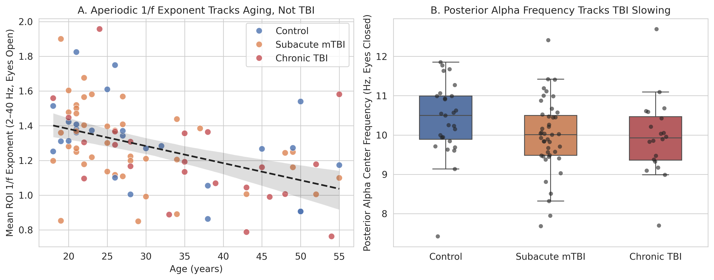
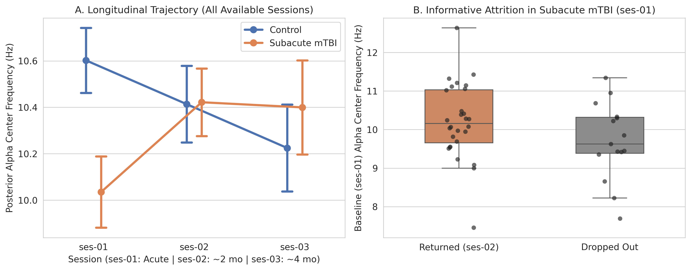

# Parameterized Resting-State EEG in Mild & Chronic TBI

An automated BIDS-to-`specparam` pipeline analyzing resting-state EEG from OpenNeuro [`ds003522`](https://openneuro.org/datasets/ds003522) (*N* = 96: Controls, Sub-acute mTBI, and Chronic TBI) to separate broadband aperiodic (1/*f*) activity from periodic alpha oscillations across acute and longitudinal recovery timepoints.

## Key Findings

### 1. Testing the 1/*f* E/I Hypothesis Reveals a Double Dissociation (`ses-01`, *N* = 93 QC-passed)
This project started from a specific hypothesis: if mild TBI disrupts cortical Excitation/Inhibition (E/I) balance, it should flatten the broadband aperiodic (1/*f*) spectral slope in resting-state EEG. Testing this directly with spectral parameterization (`specparam`, 2–40 Hz) falsified the 1/*f*–TBI hypothesis—and in doing so, exposed a clean double dissociation between normal aging and TBI that standard FFT band-power analyses conflate:

* **Aperiodic (1/*f* Exponent & Offset) → Tracks Aging, Not TBI:** Contrary to the initial E/I flattening hypothesis, neither Sub-acute mTBI nor Chronic TBI differs from Controls in Eyes-Closed or Eyes-Open rest once adjusted for age and sex in a Linear Mixed-Effects Model (*p* > 0.52). An apparent raw drop in Chronic TBI was explained entirely by an age confound: age strongly flattens the 1/*f* exponent (*β* = −0.010/yr, *p* < 0.001) and lowers offset (*p* < 0.001).
* **Periodic (Posterior Alpha Frequency) → Tracks TBI Slowing, Not Aging:** Once the age-driven 1/*f* background is factored out, TBI separates cleanly from Controls in the periodic component. Eyes-Closed posterior Individual Alpha Frequency (IAF, 7–13 Hz) is significantly slowed in TBI (**−0.45 Hz** pooled TBI, *p* = 0.042; **−0.56 Hz** in Sub-acute mTBI at high-resolution `n_fft=2000`, *p* = 0.012), independent of age (*p* = 0.55) and sex (*p* = 0.31), with no change in alpha peak power (*p* > 0.56).



### 2. Longitudinal Recovery Audit (`ses-01` → `ses-02` → `ses-03`)
A standard LMM across all available sessions (*n* = 175 recordings) yields a significant `Group × Session` interaction (*p* = 0.025 at ~2 months; *p* = 0.003 at ~4 months), superficially resembling full alpha recovery. However, a paired completer and attrition audit reveals two confounds driving the apparent rebound:

* **Informative Attrition (Survivor Bias):** Sub-acute mTBI participants who dropped out after `ses-01` (*n* = 15) had a **0.51 Hz slower** baseline IAF (**9.70 Hz**) than those who returned for `ses-02` (*n* = 29, **10.21 Hz**).
* **Control Habituation:** Paired Controls (*n* = 24) showed a significant downward drift of **−0.178 Hz** between `ses-01` and `ses-02` (*t* = −3.26, *p* = 0.0034).
* **Within-Subject mTBI Change:** Paired Sub-acute mTBI completers (*n* = 28) showed a modest, non-significant upward trend (**+0.191 Hz**, *t* = +1.40, *p* = 0.172).



## Pipeline & Methods

1. **Data Ingestion:** Automated BIDS fetching via `openneuro-py` (`ds003522`), isolating embedded 2-minute Eyes-Open (`S  1`) and Eyes-Closed (`S  3`) resting blocks from EEGLAB (`.set`/`.fdt`) recordings.
2. **Preprocessing (`MNE-Python` + `mne-icalabel`):** 250 Hz resampling, 1–100 Hz FIR bandpass + 60 Hz notch filtering, robust MAD-based bad-channel interpolation, average referencing, and Extended Infomax ICA with automated ICLabel artifact rejection (*p* ≥ 0.70).
3. **Spectral Parameterization (`specparam`):** Welch PSD (`n_fft=2000`, 0.125 Hz resolution for longitudinal IAF) fitted over 2–40 Hz with an *R*² ≥ 0.90 quality-control threshold.
4. **Statistical Modeling (`statsmodels`):** Linear Mixed-Effects Models (subject random intercepts, age/sex covariates) and paired within-subject sensitivity checks.

## Repository Structure

```text
├── notebooks/
│   └── ds003522_rest_specparam_pipeline.ipynb   # End-to-end extraction, LMMs, and plotting
├── data/
│   ├── ds003522_rest_pilot.csv                  # ses-01 aperiodic ROI parameters (N=93)
│   ├── ds003522_ses01_alpha_allgroups.csv       # ses-01 posterior alpha CF/PW (3 groups)
│   └── ds003522_longitudinal_alpha_hires.csv    # Longitudinal ses-01/02/03 high-res IAF
├── figures/
│   ├── fig1_double_dissociation.png
│   └── fig2_longitudinal_and_attrition.png
└── README.md
